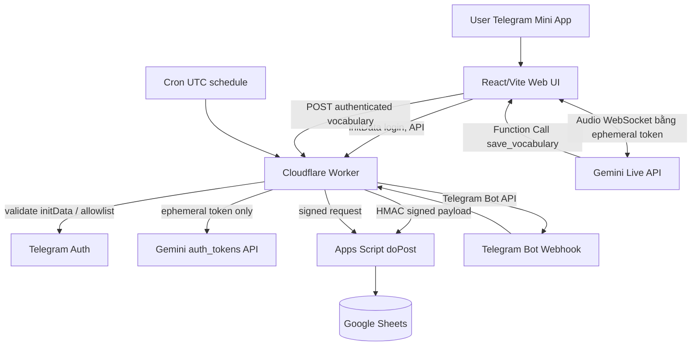

# 01 — Kiến trúc hệ thống

## Sơ đồ luồng chính

## Trách nhiệm module
- **Web frontend:** microphone AudioWorklet + 16kHz PCM nếu SDK yêu cầu; playback audio; phiên âm; trạng thái phiên; hứng function call; request backend; không lưu secret. Audio trực tiếp từ client đến Gemini bằng ephemeral token, Worker không relay audio.
- **Worker:** auth initData, allowlist 1 account, ratelimit, cấp token, validate schema, sign GAS payload, Telegram webhook, scheduled reminders, prevent duplicate events, sanitize responses. Config bằng Wrangler + secrets.
- **Apps Script:** parse signed envelope, kiểm HMAC + time window, ScriptLock, upsert/read words/reviews, bảo vệ formula injection, giữ spreadsheet là source of truth.
- **Sheets:** `Words`, `Events`, `Reviews`, `Users`, `DailyDispatchLog` (chi tiết ở data schema). Không lưu raw audio hoặc full conversation.
- **Telegram:** bot cung cấp command/menu/quiz; mini app có voice UI + màn hình ôn, user identity `initData` xác minh server side.

## Luồng lưu từ (sequence)
1. Người dùng login qua Telegram Mini App; UI gửi raw `initData` đến Worker; Worker verify HMAC, `auth_date`, allowlist.
2. Frontend `POST /api/v1/live-token` kèm phiên hợp lệ; Worker gọi Google ephemeral token service (không rò `GEMINI_API_KEY`).
3. Frontend kết nối Gemini Live, cấu hình tool `save_vocabulary`. AI phát lệnh khi xác định rõ từ/cụm từ (transcript final/intent rõ ràng).
4. UI tạo `event_id = UUIDv7` hoặc UUIDv4, gửi POST `/api/v1/vocabulary` với `word`, `sense`, `source_excerpt`, `detector_confidence`.
5. Worker kiểm auth, schema, quota & ownership; chuyển thành envelope JSON, ký HMAC; Apps Script kiểm time/sig/id, dùng ScriptLock rồi upsert `Words`, ghi `Events`; trả `word_id`.
6. Worker trả kết quả thành công cho UI; nếu mạng lỗi, frontend giữ bounded retry queue session (không localStorage token, giới hạn thời gian lưu dữ liệu); không báo success sớm.

## Luồng ôn tập
- Cron trong Worker vào `01:00 UTC = 08:00 giờ Việt Nam`; Worker gọi GAS `list_due_and_claim`, tránh gửi trùng trong `DailyDispatchLog`.
- Worker `sendMessage` Telegram, inline keyboard hoặc button mở Mini App; `callback_query` đến webhook Worker.
- Worker kiểm secret webhook + update_id dedupe, ghi `review.record` signed sang Apps Script để cập nhật `due_at`, streak/difficulty; ack callback nhanh.
- Cần retry safe: gửi nhắc rồi mới mark complete hoặc reserve/claim với expiry; lưu `dispatch_id` và tránh gửi trùng. Cron có thể lệch vài phút, KHÔNG bảo đảm đúng phút tuyệt đối.

## Chính sách lỗi / consistency
- Gemini disconnected: UI thử reconnect với session resumption; không giữ local audio sau Stop.
- AI trả sai/nhầm nghĩa: show editable; manual correction, no silent overwrite; giữ `source_excerpt` để đối chiếu.
- Apps Script timeout: Worker trả `PENDING_RETRY`, queue retry idempotent; Google Sheets consistency có giới hạn và độ trễ. Nếu không có queue serverless bền vững trong MVP, frontend retry và lưu badge `pending` (không đảm bảo sau khi đóng app); milestone thêm durable queue trước production nếu yêu cầu no-loss.
- Events có unique `event_id`; ScriptLock bao thao tác check-and-append; trả kết quả cũ nếu đã xử lý.
- No live billing? Free tier hết quota: hiển thị lỗi rõ, không tự chuyển paid API.

## Giới hạn thiết kế
Sheets phù hợp single user/light writes, không làm transaction database chuẩn. Khi multi-user / throughput tăng, repository interface đổi sang Cloudflare D1, Sheets thành export/report; ADR bắt buộc trước thay đổi.
