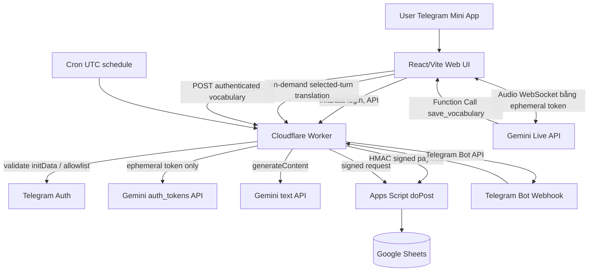

# 01 — Kiến trúc hệ thống

## Sơ đồ luồng chính

## Trách nhiệm module

- **Web frontend:** microphone AudioWorklet + 16kHz PCM nếu SDK yêu cầu; playback audio; phiên âm; trạng thái phiên; hứng function call; request backend; không lưu secret. Audio trực tiếp từ client đến Gemini bằng ephemeral token, Worker không relay audio. Transcript tự theo dõi lượt mới trừ khi người dùng đang cuộn lên đọc lịch sử; dịch riêng lượt được bấm.
- **Worker:** auth initData, allowlist 1 account, ratelimit, cấp token, validate schema, sign GAS payload, Telegram webhook, scheduled reminders, on-demand translation qua Gemini `generateContent`, prevent duplicate events, sanitize responses. Config bằng Wrangler + secrets; không lưu/log transcript gửi dịch.
- **Apps Script:** parse signed envelope, kiểm HMAC + time window, ScriptLock, upsert/read words/reviews, bảo vệ formula injection, giữ spreadsheet là source of truth.
- **Sheets:** `Words`, `Events`, `Reviews`, `Users`, `DailyDispatchLog` (chi tiết ở data schema). Không lưu raw audio hoặc full conversation.
- **Telegram:** bot cung cấp command/menu/quiz; mini app có voice UI + màn hình ôn, user identity `initData` xác minh server side.

## Luồng lưu từ (sequence)

1. Người dùng login qua Telegram Mini App; UI gửi raw `initData` đến Worker; Worker verify HMAC, `auth_date`, allowlist.
2. Frontend `POST /api/v1/live-token` kèm phiên hợp lệ; Worker gọi Google ephemeral token service (không rò `GEMINI_API_KEY`).
3. Frontend kết nối Gemini Live, cấu hình tool `save_vocabulary`. AI phát lệnh khi xác định rõ từ/cụm từ (transcript final/intent rõ ràng).
4. UI tạo `event_id = UUIDv7` hoặc UUIDv4, gửi POST `/api/v1/vocabulary` với `word`, `sense`, `source_excerpt`, `detector_confidence`.
5. Worker kiểm auth, schema, quota & ownership; chuyển thành envelope JSON, ký HMAC; Apps Script kiểm time/sig/id, dùng ScriptLock rồi upsert `Words`, ghi `Events`; trả `word_id`.
6. Worker trả kết quả thành công cho UI; nếu mạng lỗi, frontend giữ bounded retry queue session (không localStorage token, giới hạn thời gian lưu dữ liệu); không báo success sớm.

## Luồng ôn tập FSRS (Spaced Repetition)

- **Kiến trúc Authoritative Backend:** Lập lịch FSRS chạy tập trung trên Worker với thư viện `ts-fsrs`. UI chỉ preview và submit rating, không tính toán kết quả để lưu đè.
- **Tách bạch dữ liệu (Schema v3):** Bảng `Words` (thông tin từ vựng), `Cards` (trạng thái FSRS độc lập: state, stability, difficulty, due, reps, lapses), `Reviews` (append-only snapshot lịch sử và `review_log_json`), `Settings` (cấu hình FSRS cá nhân hóa).
- **Luồng ôn trên Mini App:**
  1. UI gọi `GET /api/v1/reviews/due` lấy danh sách thẻ cần ôn.
  2. Khi người dùng lật flashcard, UI gọi `GET /api/v1/reviews/:cardId/preview` để hiển thị thời gian giãn cách động trên 4 nút (`Again`, `Hard`, `Good`, `Easy`).
  3. Người dùng chọn nút đánh giá, UI gửi `POST /api/v1/reviews/submit` kèm `event_id` và `expected_version`.
  4. Worker tính toán trạng thái thẻ mới bằng `ts-fsrs` (`scheduler.next()`), gửi HMAC payload sang Apps Script.
  5. Apps Script dùng `LockService`, kiểm tra idempotency (nếu gửi lại trả về snapshot cũ), kiểm tra phiên bản thẻ, cập nhật `Cards` và append `Reviews`.
- **Luồng ôn qua Telegram Bot & Cron:**
  - Cron trong Worker vào `01:00 UTC = 08:00 giờ Việt Nam`; Worker gọi GAS `review.claimDigest`, tránh gửi trùng trong `DailyDispatchLog`.
  - Worker `sendMessage` Telegram kèm inline keyboard hoặc nút mở Mini App; `callback_query` gửi đến webhook Worker.
  - Người dùng tự đánh giá Again/Hard/Good/Easy trên keyboard theo Card ID/version. Worker replay lookup trước đọc Card/Settings, rồi tính FSRS và gửi `review.record` đã ký. Word ID cũ được repository resolve như alias.
  - Cần retry safe: gửi nhắc rồi mới mark complete hoặc reserve/claim với expiry; lưu `dispatch_id` và tránh gửi trùng. Cron có thể lệch vài phút, KHÔNG bảo đảm đúng phút tuyệt đối.

## Chính sách lỗi / consistency

- Gemini disconnected: UI thử reconnect với session resumption; không giữ local audio sau Stop.
- AI trả sai/nhầm nghĩa: show editable; manual correction, no silent overwrite; giữ `source_excerpt` để đối chiếu.
- Apps Script timeout: Worker trả `PENDING_RETRY`, queue retry idempotent; Google Sheets consistency có giới hạn và độ trễ. Nếu không có queue serverless bền vững trong MVP, frontend retry và lưu badge `pending` (không đảm bảo sau khi đóng app); milestone thêm durable queue trước production nếu yêu cầu no-loss.
- Events có unique `event_id`; ScriptLock bao thao tác check-and-append; trả kết quả cũ nếu đã xử lý.
- No live billing? Free tier hết quota: hiển thị lỗi rõ, không tự chuyển paid API.

## Giới hạn thiết kế

Sheets phù hợp single user/light writes, không làm transaction database chuẩn. Khi multi-user / throughput tăng, repository interface đổi sang Cloudflare D1, Sheets thành export/report; ADR bắt buộc trước thay đổi.
