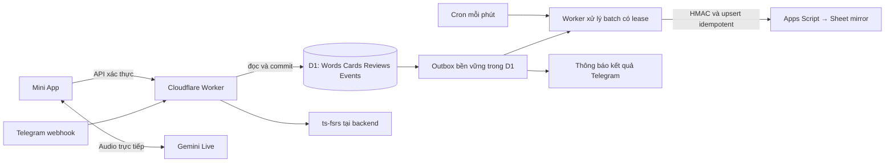

# M5-13 — Kế hoạch giảm độ trễ và chuyển D1 thành kho dữ liệu chính

Ngày: 13/10/2026, UTC+7. Trạng thái: **PLAN ONLY**. Chưa sửa runtime, tạo database, import dữ liệu hoặc deploy. Kế hoạch dựa trên source main `adf0aea`, release M5-12 và tài liệu chính thức kiểm tra ngày 13/10/2026.

Người dùng đã chọn: **Sheet chỉ dùng xem/xuất; sửa dữ liệu qua app**. D1 trở thành nguồn dữ liệu có thẩm quyền. Đồng bộ một chiều D1 → Sheet. Lập kế hoạch không đồng nghĩa đã được phép thực thi cutover production.

## 1. Mục tiêu và phạm vi

- Mini App ghi từ và nhận ACK từ D1, không chờ Apps Script hoặc việc tải lại toàn bộ giao diện.
- Telegram phản hồi nút bấm sớm, lưu review/lịch FSRS vào D1 và cập nhật tin nhắn sau commit.
- Giữ nguyên từ, ID, nghĩa đã sửa, các Card độc lập, lịch đến hạn, số lần ôn, lịch sử Reviews, Settings, idempotency Events và trạng thái gửi thông báo.
- Sheet trở thành bản xem/xuất có độ trễ cho phép. Sheet hỏng/chậm không ngăn người dùng lưu từ và ôn tập.
- Dùng Workers/D1 Free, không yêu cầu máy tính chạy 24/7, không bật paid plan hoặc thêm Queues/R2/Durable Objects trong phạm vi mặc định.
- Không thêm model AI, đổi thuật toán FSRS, tạo UI Settings/CSV restore hoặc bổ sung tính năng ôn mới trong đợt này.

## 2. Những điểm đã thấy trong code

| Điểm | Bằng chứng source | Hướng xử lý |
| --- | --- | --- |
| Telegram ACK sau ghi review | `apps/worker/src/entry.ts`: `recordReview` rồi mới `answerCallbackQuery` | ACK “Đang ghi nhận…” sau auth/validation; kết quả thật cập nhật tin nhắn sau commit |
| Review qua GAS có ba request tuần tự | `apps/worker/src/adapters/gas-client.ts`: `review.lookup` → `card.get` → `review.record` | Thay bằng D1 repository; giữ replay trước đọc trạng thái, đọc context rồi commit có OCC |
| Mini App đợi refresh sau write | `apps/web/src/app/App.tsx`: lưu → `await refresh()` gồm vocabulary/due/stats | Trả tool result sau write ACK; refresh nền, gộp các lượt gần nhau và tải theo tab |
| Recovery có chờ bổ sung | `vocabulary-capture.ts`: đợi turnComplete + grace 1.500 ms | Đo riêng direct/recovery; ưu tiên tool sớm, giữ budget và không cắt validation |
| GAS nhiều thao tác ô/read toàn cột | `apps-script/Code.gs`: `findRow_`, `setValue`, `flush`, ScriptLock | Loại khỏi đường tương tác; mirror dùng batch reads/writes |
| Dedup Telegram theo isolate | `SecurityStateStore` trong `entry.ts`; Events bảo vệ rating qua GAS | D1 giữ mutation replay và update/delivery state bền vững; memory chỉ hỗ trợ |

Log cũ từng có GET vocabulary 4.099 ms; đó không phải benchmark POST hoặc review. Chưa có breakdown live, nên chưa quy toàn bộ độ trễ cho một thành phần hay cam kết tốc độ sau chuyển đổi.

Không tối ưu lại toàn bộ `review.prepare` trên GAS rồi bỏ đi: D1 thay luồng đó. Chỉ tối ưu GAS cho export/mirror cần giữ lại.

## 3. Kiến trúc đích

- `VocabularyRepository` và `ReviewRepository` vẫn là boundary; thêm `D1VocabularyRepository`, `D1ReviewRepository` và một factory dùng chung cho HTTP/Cron.
- Cờ `DATA_BACKEND=gas|d1` chọn một backend cho cả đọc và ghi. Khi chọn D1 nhưng thiếu binding/schema thì fail closed; không tự fallback ghi GAS.
- Binding `DB` chỉ trong Worker, tách local/staging/production. Giữ API routes và envelope công khai tương thích; frontend cũ đang mở vẫn hoạt động.
- API trả success sau transaction D1, không sau khi xếp vào queue memory. Word/Card/Event/outbox được ghi cùng transaction.
- Giữ luồng audio trực tiếp Gemini và token `uses:1`. D1 không làm nhanh thời gian model nghe/hiểu/sinh tool; phải đo phần đó riêng.
- Không dùng read replica giai đoạn đầu; đọc/ghi primary nhất quán để giảm độ phức tạp khi đọc ngay sau write.
- Giữ auth/session secret hiện hành khi cutover. `SESSION_SIGNING_SECRET` đang fallback `GAS_SHARED_SECRET`; không xóa/đổi GAS secret làm hỏng phiên cũ. Tách key là maintenance riêng sau khi kiểm chứng tương thích.

## 4. Hợp đồng dữ liệu và transaction

Giữ schema domain v3; D1 dùng SQL schema version riêng và migrations append-only. Không tự nâng hoặc tính lại FSRS trong khi import.

| Bảng D1 dự kiến | Khóa/đặc điểm cần giữ |
| --- | --- |
| `words` | `word_id` PK; UNIQUE user + lemma chuẩn hóa + POS + sense; Word version và soft delete |
| `cards` | `card_id` PK; FK Word, owner cùng Word; nhiều Card/Word; state/due/memory/row_version đầy đủ |
| `reviews` | `review_id` PK; UNIQUE event; append-only; native log, snapshot trước/sau, scheduler/parameters version |
| `events` | event ID duy nhất; owner/action/fingerprint/result snapshot; replay gốc ngay cả Word đã xóa hoặc Settings đã đổi |
| `settings`, `users` | Cấu hình FSRS và Telegram preferences, timezone/opt-out/limits giữ nguyên |
| `daily_dispatches` | UNIQUE user + ngày UTC+7; claim token/attempt/sent/failed/unknown giữ nguyên |
| `telegram_updates`, `telegram_deliveries` | update ID duy nhất và kết quả xử lý; job cập nhật tin nhắn tách khỏi mutation |
| `sync_outbox`, `migration_runs`, `system_state` | Công việc đồng bộ có lease, checkpoint import/verify, chế độ maintenance và source epoch |

Index tối thiểu: Cards(owner, suspended, due, card_id), Reviews(owner, reviewed_at), Words(owner, deleted, created_at, word_id), outbox(status, next_attempt_at, sequence), dispatch(owner, local_date). Search bounded/paginated; không thêm FTS ở đợt đầu để giữ export/restore đơn giản. Dùng `EXPLAIN QUERY PLAN` và `rows_read` để chứng minh queue/stats không full scan vô ích.

### Mutation và FSRS

1. Runtime Zod validate input/DB rows, prepared statements và bind parameters; không nối SQL từ input.
2. Lookup Events trước khi đọc Card/Settings. Cùng event + cùng client payload trả snapshot cũ; payload đổi trả 409.
3. Backend đọc Card + Settings một context, dùng nguyên `ts-fsrs` đã khóa phiên bản; retention 0,90/defaults từ shared. Không chạy scheduler trên web để ghi lịch.
4. Commit Card + Review + Event + mirror outbox + Telegram completion delivery (nếu có) atomically; Word compatibility mirror cập nhật trong cùng transaction khi API còn cần.
5. OCC kiểm `Card.row_version` và owner/Word active ngay trong transaction. SQL guard/trigger phải gây lỗi nếu điều kiện sai để cả `DB.batch()` rollback; `UPDATE ... WHERE version=?` trả 0 dòng tự nó **không** rollback các statement khác. Không kiểm kết quả ở JavaScript sau khi các writes đã commit.
6. Nếu hai request cùng event đụng UNIQUE, đọc lại Event đã commit và so fingerprint; không tính lại scheduler cho replay. Hai events cùng Card version chỉ một được ghi.
7. Reviews không UPDATE/DELETE qua application; DB guard bảo vệ append-only. Không hard-delete Word để giữ audit/FK.

Cloudflare hỗ trợ transaction bằng [`DB.batch()`](https://developers.cloudflare.com/d1/worker-api/d1-database/#batch). Cách thực thi SQL guard phải được thử trên D1 local và staging thật; không dựa vào SQLite mock để tuyên bố pass D1.

### Events cũ là điểm cần xử lý riêng

GAS đang dùng **HMAC với GAS_SHARED_SECRET** trên JSON action/user/data làm fingerprint. Không đổi ngay sang hash mới rồi coi Events nhập vào đã tương thích. Adapter phải có `fingerprint_scheme` và builder legacy tái tạo chính xác field/order/null/alias, dùng key hiện hữu ở Worker; dữ liệu export chỉ chứa hash, không chứa key.

Events thiếu result snapshot/legacy fingerprint không đủ thông tin phải giữ trạng thái cần đối chiếu và trả conflict khi replay, không bịa success. Có fixture cho retry mutation trước cutover sau khi đã chuyển D1, kể cả Telegram callback cũ.

## 5. Giảm độ trễ Mini App và capture

- Sau create ACK: cập nhật badge/queue, trả `{ok:true}` cho Gemini ngay; refresh chạy nền và có catch/diagnostics, không biến lỗi refresh thành “lưu thất bại”.
- Gộp refresh phát sinh liên tiếp; chỉ một lượt đang chạy, lượt cuối bị supersede có guard. Voice không bắt buộc tải due/stats cho mỗi từ; review tab tải dữ liệu review khi cần.
- Sau submit rating: cập nhật queue thẻ từ response server, fetch stats nền; không để các GET phụ kéo dài nút chấm điểm.
- Pending trước commit và saved sau commit phải phân biệt rõ. “Đã lưu” là D1 durable; trạng thái Sheet đồng bộ hiển thị riêng khi có lỗi/lag, không bắt user hiểu chi tiết hệ thống.
- Đo monotonic timestamps theo capture ID riêng, không chứa transcript/từ/audio: final ASR → intent → tool → POST → ACK. Đánh dấu direct/recovery và reason enums.
- Cải thiện prompt/declaration để tool được gọi ngay khi đủ target/meaning, trước giải thích dài. Không yêu cầu save trước khi xác định nghĩa, không gọi AI theo audio chunk.
- Giữ grace 1,5 giây ban đầu. Chỉ giảm sau khi có distribution ASR/tool muộn và regression cho ordering/dedup/Stop/audio; giảm timer mù có thể làm tăng recovery hoặc ngắt câu trả lời.
- Không thêm fallback text-model trong đợt này. Nếu model không gọi tool, recovery vẫn có budget và báo chưa lưu đúng thực tế.

## 6. Telegram và Cron

- Sau webhook secret/owner/callback validation, gọi ACK “Đang ghi nhận…” sớm với timeout ngắn, không chờ GAS/Sheet. ACK này không phải success review.
- Lưu review D1 cùng idempotency/update result và completion delivery. HTTP webhook 200 khi mutation đã commit hoặc đã có replay; lỗi transient trước commit trả non-2xx để Telegram retry. Không đánh dấu processed sớm chỉ vì đã ACK nút.
- Mutation thành công nhưng sửa tin nhắn lỗi: vẫn replay review gốc, không chấm lại. Delivery job có thể cập nhật lại **cùng message_id** idempotently; “message not modified” được coi đã đạt kết quả sau validation.
- Delivery có message revision/sequence guard; job cũ không ghi đè nội dung kết quả mới hơn trên cùng message. Callback inline không có chat/message ID phải xử lý riêng hoặc trả hướng dẫn `/review`, không tạo job thiếu địa chỉ rồi bỏ lỗi.
- Thành công: cập nhật tin nhắn với rating và next_due_at server; gỡ keyboard cũ. Stale button báo cần `/review` lại, không chấm phiên bản mới bằng nút cũ.
- Callback cũ dùng Word alias hoặc thiếu version vẫn tương thích như API hiện hành; preserve IDs để keyboard đang có không hỏng. Bound 64 bytes giữ nguyên.
- `/review`, `/start`, `/pause`, digest 08:00 đọc/ghi D1; không để một command hoặc Cron còn dùng GAS repo sau cutover.
- Command/digest `sendMessage` không có exactly-once: kết quả network không chắc chắn chuyển `unknown`, không tự gửi lại gây spam. Retry lỗi xác định tối đa ba lần như ADR-007. ACK Telegram lỗi không làm rollback review đã commit.
- Dùng một Cron mỗi phút cho outbox/delivery và retry digest có điều kiện 08:00–08:05 UTC+7; thay trigger cũ, không bật hai scheduler gửi cùng lúc. Claim digest theo user/ngày trong D1; skip dispatch khi maintenance/opt-out.
- `ctx.waitUntil()` chỉ là đường thử xử lý delivery sau response; công việc thật nằm trong D1 để Cron phục hồi. Không dùng fire-and-forget hoặc waitUntil đơn lẻ làm durable queue. [Cloudflare context](https://developers.cloudflare.com/workers/runtime-apis/context/#waituntil)

## 7. Sheet mirror một chiều và chịu lỗi

Chọn **D1 outbox + Worker Cron** cho quy mô cá nhân; chưa cần Cloudflare Queues. Có thể thay processor sau này mà không đổi domain/mutation.

1. Mỗi mutation tạo outbox record cùng transaction, có sequence tăng, event/type/entity/version và dữ liệu cần đồng bộ.
2. Processor claim batch bằng lease token/expiry trong D1; hai Cron không xử lý cùng lease. Batch theo cả số events và UTF-8 size; mặc định ≤10 events và signed payload ≤12 KB, tự chia nhỏ nếu cần. Review snapshots lớn phải được xử lý theo budget, không cắt mất audit.
3. Apps Script thêm action HMAC `mirror.applyBatch`, validate tất cả rows trước writes, dùng ScriptLock và batch reads/writes. Chỉ mirror canonical snapshots, không tính FSRS/không gọi legacy upsert làm tăng times_asked lần nữa.
4. Words/Cards upsert theo ID + version; version cũ đến muộn không ghi đè version mới. Reviews/Events append theo stable ID, retry không nhân đôi. `SyncMeta` ghi checkpoint/ACK; partial write được retry và đối chiếu theo từng ID.
5. Mirror ACK mất sau Google đã ghi: gửi lại cùng batch/event IDs và nhận cùng kết quả. Chỉ mark delivered sau ACK hợp lệ. Không mark thành công chỉ vì HTTP 200, do GAS trả business error trong JSON.
6. Retry transient có exponential backoff/jitter, tối đa 8 attempts trong tối đa 24 giờ; sau đó giữ dead-letter để chủ dự án retry/đối chiếu. Validation/auth/conflict không retry mù. Không xóa payload chưa đồng bộ.
7. Entity có thứ tự phụ thuộc: Word trước Card, Card trước Review; mỗi batch giữ sequence, version guards xử lý retry/out-of-order. Reviews giữ đầy đủ lịch sử, không coalesce. Phase đầu chưa coalesce các event để giảm rủi ro bỏ sót.
8. D1 saved + mirror lỗi: app/Telegram vẫn ôn bình thường; hiện trạng thái đồng bộ chậm, queue depth/oldest age/last success để kiểm tra. Không gửi tin nhắn cảnh báo lặp cho mỗi event.
9. Sheet existing giữ nguyên làm backup khi cutover; khuyến nghị mirror vào Spreadsheet mới hoặc các tab `D1_*` mới, tránh ghi đè bản gốc. Mapping cụ thể chốt trong staging theo lựa chọn giữ workbook của chủ dự án; không tự thay sharing/permissions. Tabs mới có banner “Bản xem, chỉnh sửa trong app”.
10. Không đọc thay đổi thủ công trên mirror ngược về D1. Đối chiếu theo ID/version/hash để phát hiện mirror bị sửa hoặc thiếu, rồi rebuild từ D1 có backup trước. Formula injection vẫn bị chặn ở boundary Sheet; xử lý escaping đúng một lần, không tích lũy dấu quote qua import/export.

Mục tiêu lag bình thường ≤5 phút. Cron/Google không có cam kết chạy đúng giây; khi Google lỗi sẽ hiển thị lag và phục hồi sau, không chặn thao tác chính.

## 8. Kế hoạch dữ liệu: rehearsal → freeze → import → verify → cutover

### Chuẩn bị và export

- Inventory read-only: đúng Sheet/deployment/owner, đủ tabs, headers, counts, ID duplicates, Cards/Reviews orphan, UTC/due/version, Events result/hash, Settings, DailyDispatch sent/unknown. Chưa sửa Sheet để “làm sạch” tự động.
- Backup **đầy đủ** Words, Cards, Reviews, Events, Settings, Users, DailyDispatchLog cùng metadata/schema. CSV Words hiện tại không đủ để migrate FSRS. Artifacts dữ liệu thật ngoài Git, hạn chế truy cập; manifest/count/checksum không đưa nội dung học vào console.
- Dự kiến thêm GAS action read-only `migration.exportPage` có HMAC, owner, pagination/body bound; chỉ được dùng bởi tool migration có quyền server, không công khai thành route frontend. Nếu quyền Google Sheets API hiện có đủ thì có thể dùng exporter read-only tương đương; không xin OAuth rộng hơn chỉ để tiện.
- Trước sửa GAS: clasp pull vào backup riêng, diff đã redacted, kiểm test rồi push/version/redeploy đúng deployment sau khi được phép; cấm force. Không chạy `runQuickSetup`, không ghi lại secrets/properties ngoài thay đổi đã review. Setup literal legacy cần được loại bỏ an toàn trong bản GAS mới mà không rotate key ngoài phạm vi.
- Exporter chạy lại/resume được; snapshot nhất quán chỉ được chốt khi mọi writer đã freeze và request đang chạy đã drain. Export trong khi app đang ghi chỉ dùng rehearsal, không dùng làm final snapshot.

### Import staging / local

- Schema migrations versioned trong `apps/worker/migrations/`; dùng D1 local trước, sau đó staging tách production. Không hardcode database ID hoặc import file thật vào Git.
- Import có `migration_run_id`, source checksum, chunk checkpoints. Import lại cùng manifest không tăng times_asked/reps hoặc tạo lại event; không dùng API business upsert/review để nhập lịch sử.
- Giữ nguyên IDs, UTC times, Word version, Card row_version, due/memory/native logs, settings và dispatch state. Dates/booleans/numeric Sheet được parse/validate, không đổi rỗng thành số 0 khi domain không cho phép.
- Nếu thiếu Card legacy: dry-run phải báo riêng; chỉ materialize theo quy tắc migration FSRS hiện hành, giữ due/counts/archive, không ước tính stability hoặc viết lại thuật toán. Đã có FSRS Card thì không cold-start lại.
- Rows không hợp lệ/duplicate key/FK/hash thiếu được quarantine vào report ngoài Git; unresolved ảnh hưởng lịch sử/replay là blocker cutover. Không tự gộp hai nghĩa hoặc xóa Reviews để import pass.
- Verify không chỉ row counts: canonical hash từng row/ID set, unique key, FK/owner, active/deleted/suspended counts, due distribution, tổng Reviews/Events, settings/version và đầy đủ snapshot. `quick_check`/`foreign_key_check` pass.
- Shadow compare read-only cùng `nowIso`, owner, limit/sort với GAS snapshot: vocabulary, due, stats, preview bốn ratings. Candidate ratings chạy trên **bản staging riêng**, không ghi hai kho production.

### Cutover production

1. Ghi versions Worker/Pages/GAS, schema, backup manifest và mốc thời gian UTC. Chuẩn bị build/rollback tương thích D1 trước khi bắt đầu.
2. Bật maintenance cho mọi mutation từ web, Bot, Cron và legacy GAS business actions; cho phép health/read cần thiết. Báo rõ đang chuyển dữ liệu, không nhận write vào queue memory rồi giả success.
3. Dừng direct edits trên Sheet; drain writers đang chạy, lấy final snapshot ổn định. Retry Telegram đang chờ phải được bảo toàn để xử lý sau mở lại, không mark processed khi chưa commit.
4. Import D1 production đã tách biệt, chạy toàn bộ verify và lấy backup/bookmark trước mở writers. Mục tiêu cửa sổ bảo trì 10–20 phút sau rehearsal; đây là dự toán, không phải lịch hẹn/cam kết.
5. Deploy Worker chọn D1 cho **tất cả** HTTP/Bot/Cron, giữ routes/session compatibility. Đọc lại binding/backend/schema thực tế; chưa có request ghi mới thì có thể quay về GAS snapshot nếu smoke thất bại.
6. Mở writes D1, thử một từ mới và một review thật, retry cùng event và old keyboard. Kiểm Word/Card/Review/Event/outbox và due; rồi mở mirror processor. Không bật lại legacy GAS writers; chỉ cho phép actions mirror/read-only cần thiết.
7. Theo dõi lỗi/latency/mirror trong phiên đầu và kiểm lại sau 24–48 giờ theo task QA riêng. Không tạo automation theo dõi trong task lập kế hoạch này.

## 9. Rollback không làm mất lượt học

- **Trước write D1 đầu tiên:** rollback Worker/backend về GAS đã freeze snapshot; xác minh không phát sinh D1 event mới, rồi mới mở writers GAS.
- **Sau khi D1 đã có write:** ưu tiên rollback **code tương thích cùng D1**, không flip cờ về Sheet cũ. Schema đổi theo expand/contract, chưa drop cột/bảng trong đợt đầu.
- Nếu buộc quay GAS: freeze writers; export D1 mới nhất, phục hồi đầy đủ Words/Cards/Reviews/Events/Settings/dispatch vào GAS; đối chiếu checksum/version/FSRS/replay, chỉ sau đó chuyển authority. Mirror trễ không phải backup để quay lại trực tiếp.
- Sheet mirror hỏng: dừng processor, app vẫn dùng D1; sửa/rebuild mirror từ D1. Không rollback database chính chỉ vì Google lỗi.
- D1 unavailable/quota: typed error và maintenance/pending đúng thực tế, không tự ghi sang GAS tạo hai nguồn dữ liệu.
- Time Travel Free có cửa sổ 7 ngày; restore là thao tác làm lùi dữ liệu nên phải snapshot hiện tại và đối chiếu các writes sau điểm phục hồi. [Time Travel](https://developers.cloudflare.com/d1/reference/time-travel/)
- Có SQL export trước migration/deploy và quy trình export định kỳ thủ công ra nơi chủ dự án kiểm soát, diễn tập restore vào DB tách biệt. Không mặc định tạo R2 hoặc pipeline backup có secrets mới. Export có thể chặn truy vấn khi chạy, cần chọn thời điểm phù hợp. [Import/export D1](https://developers.cloudflare.com/d1/best-practices/import-export-data/)

## 10. Chỉ số và tiêu chí hiệu năng

Các số dưới đây là **mục tiêu nghiệm thu dự kiến**, chưa phải kết quả đo hoặc cam kết SLA. Chốt lại sau baseline, cùng thiết bị/mạng và phân tách các chặng.

| Chỉ số | Mục tiêu ban đầu | Đo như thế nào |
| --- | --- | --- |
| Backend create/review | p95 ≤800 ms | Worker receipt → response, sau auth; ghi riêng auth/DB/FSRS/total |
| Tool hợp lệ → badge saved | p95 ≤1,5 giây | Browser monotonic timer; không tính thời gian Gemini nghe/sinh tool |
| Telegram callback ACK | p95 ≤1 giây | Worker receipt → answerCallbackQuery ACK, độc lập review commit |
| Telegram kết quả rating | Thường ≤2 giây trên mạng thử ổn định | Webhook → editMessage ACK + user quan sát; ghi retry/delivery riêng |
| Đồng bộ Sheet khi Google khỏe | p95 lag ≤5 phút | D1 committed_at → mirror confirmed_at, queue oldest age |
| Toàn vẹn | 0 lost mutations / 0 double reviews | Crash injection, retry/lost ACK, concurrent OCC và manifests |
| Độc lập Google | App/Telegram vẫn save/review khi GAS timeout/503 | Fault injection integration và staging controlled |

- Baseline ít nhất 30 thao tác mỗi luồng synthetic/staging, lặp 50 sau sửa cùng điều kiện; live cá nhân kiểm vài lượt có xác nhận, không spam Bot hoặc sinh hàng loạt từ thật.
- Báo p50/p95/max + số mẫu, warm/idle/reconnect, direct/recovery. Không lấy một health probe làm số đo ghi dữ liệu.
- Log metadata whitelist: request/capture correlation, backend/action, duration, status, retry count, rows_read/written; không transcript, word, audio, session/token/HMAC hoặc endpoint có key.
- Capture diagnostics phải copy được ngay cả khi mọi HTTP đều 200; panel hiện tại chỉ xuất hiện sau API failure nên chưa đủ điều tra model delay.
- D1 metrics và query plan chứng minh indexed reads; report Workers CPU cùng FSRS serialization để bảo đảm hợp Free. Không tự nâng Paid nếu CPU vượt; tối ưu và báo lại số đo trước quyết định.

## 11. Free tier và vận hành

Theo [giá D1](https://developers.cloudflare.com/d1/platform/pricing/) và [limits](https://developers.cloudflare.com/d1/platform/limits/) đã kiểm tra 13/10/2026: 5 triệu rows read/ngày, 100.000 rows written/ngày, 5 GB tổng/tài khoản, 500 MB/database Free. Giới hạn tính trên cả account; indexes cũng góp rows written. Free hết read/write quota sẽ từ chối query tới kỳ reset, không tự chuyển paid.

- Cron mỗi phút khoảng 1.440 lần/ngày; khi không có job chỉ một indexed lookup rỗng, không quét Reviews. Batch có budget theo query/body/runtime limits. Tách một database staging và một production trong quota account hiện có, kiểm dashboard trước tạo.
- Workers Free có 100.000 requests/ngày và HTTP CPU budget 10 ms/invocation theo [Workers pricing](https://developers.cloudflare.com/workers/platform/pricing/). Đo CPU `ts-fsrs`/JSON/HMAC thực tế, không nhầm thời gian chờ mạng với CPU hoặc dùng quota D1 để suy Worker không có giới hạn.
- Mục tiêu ngân sách app ban đầu <10% quota rows/ngày, cảnh báo nội bộ 50%/80% và dung lượng gần 350 MB/database. Không coi đây là quota Google/Gemini hoặc cam kết miễn phí toàn bộ ứng dụng.
- Reviews/Events replay không tự xóa để tiết kiệm dung lượng; theo dõi growth. Outbox delivered có thể dọn sau 7 ngày nếu snapshot/audit chính vẫn còn; dead-letter/unacked không xóa.
- Plan không phụ thuộc Queues/R2/Paid. Nếu cần scale/backup tự động mới, mở ADR/task và kiểm chi phí trước.

## 12. Các task triển khai và dependencies

| ID | Công việc/đầu ra | Acceptance trước khi đóng |
| --- | --- | --- |
| M7-01 | Baseline + diagnostic timings/capture reasons; report môi trường/sample | Phân biệt Gemini, API/DB, refresh, Telegram ACK; không log nội dung; có baseline p50/p95 và privacy tests |
| M7-02 | Mini App ACK/refresh nền và ACK Telegram sớm | Saved chỉ sau commit; refresh lỗi không phủ định save; audio không block; nút phản hồi sớm nhưng chưa giả success; regression tests |
| M7-03 | SQL migrations, D1 binding/types/factory, config gates | Local/staging isolation; unique/FK/OCC/append-only guards thực thi trên D1; schema/version mismatch fail closed |
| M7-04 | D1 Vocabulary/Review repositories và FSRS transaction | CRUD/preview/stats/alias/replay parity; concurrent event/version; rollback toàn batch; ts-fsrs/native logs/Settings đúng |
| M7-05 | Telegram commands/dedup/deliveries + Cron dùng D1 | /review/start/pause, keyboard cũ, duplicate update, lost Telegram ACK; digest không spam, sent/failed/unknown và outbox phục hồi |
| M7-06 | D1 outbox processor + GAS mirror batch một chiều | Atomic enqueue/lease/retry/version guards; mất ACK không duplicate; GAS down không chặn app; dead-letter/lag/rebuild có test |
| M7-07 | Full exporter/importer/dry-run/verify/rollback tools | Đủ 7 tabs; IDs/FSRS/Events HMAC preserved; invalid rows báo cáo; import rerun không mutate; manifests và freeze/drain runbook |
| M7-08 | Staging rehearsal, data parity và benchmark | D1 runtime thật, auth/CORS, failure/retry/concurrency; import/restore rehearsal; đạt dữ liệu 100% và mục tiêu latency đã chốt |
| M7-09 | Cutover production có backup/gates/phiên bản | Final freeze snapshot/verify; D1 authority mọi entrypoint; real save/review/old callback/retry; rollback code giữ D1 sẵn sàng |
| M7-10 | Nghiệm thu vận hành + bàn giao | Live Good/due/native Reviews, thiết bị khả dụng, mirror outage/recovery, quota/CPU/growth, backup restore; ghi việc còn thiếu rõ ràng |

Đường găng: M7-01 → M7-03 → M7-04 → M7-05/M7-06/M7-07 → M7-08 → M7-09 → M7-10. M7-02 làm sớm để cải thiện UX; chưa cần chờ migration. Có thể chia source theo modules nhưng kế hoạch không mặc định dùng subagents.

Mỗi task: branch riêng, cập nhật PROGRESS/CHANGELOG cùng commit, regression trước/sau khi có lỗi tái hiện; typecheck/lint/test/build, D1 runtime checks, Worker dry-run/secret scan/diff check và CI trước merge. Không đánh dấu task implementation xong từ tài liệu.

## 13. File/modules dự kiến và tài liệu phải cập nhật

- `apps/worker/src/adapters/d1-*.ts`, repository factory/application services, `domain/env.ts`, `entry.ts`, `wrangler.toml`, `apps/worker/migrations/*.sql` và runtime types.
- `apps/worker/src/.../outbox-processor.ts`, Telegram delivery adapter; `apps-script/Code.gs`/manifest nếu scope cần thiết; HMAC export/mirror contracts trong `packages/shared/src/contracts/api.ts`.
- `apps/web/src/app/App.tsx`, API diagnostics/panel, `vocabulary-capture.ts`/Live client và test fixtures liên quan; không đưa Cloudflare/Node imports vào web/shared.
- `scripts/` tools export/import/verify/rollback, artifacts riêng ngoài Git; `tests/` D1 integration, migration, outbox, App/Telegram và fault-injection; CI setup local D1 runtime thật.
- `docs/01_ARCHITECTURE.md`, `08_API_CONTRACTS.md`, `09_DATA_SCHEMA.md`, `14_DECISIONS.md`, `17_COSTS_AND_LIMITS.md`, setup Cloudflare/GAS, FSRS migration/test plan, README/PROGRESS/CHANGELOG. Giữ rõ đang proposed hay đã deploy.

## 14. Ước lượng và điểm dừng

Ước lượng công sức triển khai, không phải lịch tự động: baseline/UX khoảng 0,5–1 ngày; schema/repositories/Telegram 2–3 ngày; mirror/migration tools 1–2 ngày; rehearsal/cutover/QA 1–2 ngày, cộng cửa sổ quan sát 24–48 giờ. Tổng khoảng **5–8 ngày làm việc**, có thể tăng nếu dữ liệu legacy cần đối chiếu. Không hứa chuyển an toàn trong một hotfix.

Phải dừng cutover khi: backup chưa verify, duplicate/orphan/audit/fingerprint chưa xử lý, staging rollback chưa pass, Free CPU/quota không đạt, hoặc bất kỳ entrypoint nào còn ghi kho cũ. Chuẩn bị code/artifact/runbook đầy đủ trước khi xin xác nhận hành động production; không yêu cầu người dùng duyệt một đề xuất chưa cụ thể.

Bước tiếp theo sau khi được yêu cầu triển khai: mở M7-01, ghi baseline và diagnostic regression; làm M7-02 để giảm chờ ngay, rồi D1 local schema/M7-03. M5-12 rating live QA còn pending được nghiệm thu cùng M7-08/M7-10, không tự đánh dấu hoàn thành ở bước lập kế hoạch.
